# Hi, I'm Malik Dixon

### Secure systems. Human impact.

**AI Agent & MCP Security · Cloud Engineering · DevSecOps**

I'm a U.S. Army veteran, engineer, and systems builder working across AI, cloud, security, and full-stack development. I build and assess workflows with clear permissions, meaningful human oversight, and evidence people can inspect.

My focus is on what an agent can access, what it can change, who authorizes the action, and how we verify the result.

[Portfolio](https://www.malikwdixon.com/) · [MCP security assessment](https://www.malikwdixon.com/services/mcp-readiness/) · [Contact](https://www.malikwdixon.com/contact/) · [LinkedIn](https://www.linkedin.com/in/malik-dixon/)

---

## How I can help

### AI Agent & MCP Security Assessments

I help teams review a defined agent workflow before launch or a customer security review. The assessment covers **permissions, data access, oversight, evidence, and response readiness** across agents, Model Context Protocol (MCP) servers, and connected tools.

Deliverables include a readiness scorecard, prioritized findings, a fix plan with owners and acceptance checks, and a reviewable evidence pack. Scope, access, timing, and price are agreed before work begins.

[Explore the MCP Readiness & Security Assessment](https://www.malikwdixon.com/services/mcp-readiness/)

### Inquiry Workflow Pilot

For small B2B service teams, I offer a proposed pilot around one inquiry workflow: intake, routing, ownership, follow-up, and exception handling. We map the handoffs, agree on a baseline, and test where automation adds value.

[Explore the workflow pilot](https://www.malikwdixon.com/services/workflow-assessment/)

## Featured engineering work

| Project | Stage | Engineering focus |
| --- | --- | --- |
| [**TraceLogicAI**](https://www.malikwdixon.com/projects/tracelogicai/) | Live · Active development | Compare Plain, RAG, MCP, Agent, and Security-aware pipelines through evaluation, trace inspection, and permission-aware workflow design. [Explore product](https://tracelogicai.com/). |
| [**ConstatAI**](https://www.malikwdixon.com/projects/constatai/) | In development | AIOps and DevSecOps assurance built on [Project Sentinel](https://github.com/mdixon47/project-sentinel-terraform). Connect AWS detection evidence, AI-assisted investigation, and response governed by deterministic controls. |
| [**RevenuePilotAI**](https://www.malikwdixon.com/projects/revenuepilotai/) | Active development | Coordinate specialist agents for account research, grounded product knowledge, sales planning, and CRM action preparation with human review. The documented CRM executor uses mock data. |
| [**Operation Aegis**](https://www.malikwdixon.com/projects/operation-aegis/) | Completed demonstration | Docker and GitHub Actions tests and security checks for a simulated fintech delivery workflow. [Inspect repository](https://github.com/mdixon47/operation-aegis). |
| [**AuditTrail SDK**](https://www.malikwdixon.com/projects/audittrail-sdk/) | Completed capstone | AWS resource inventory, structured audit evidence, and an audit API using temporary credentials. [Inspect repository](https://github.com/mdixon47/audittrail-sdk). |

Each project record links its documented scope, evidence, and limitations. ConstatAI's recorded cloud labs are shut down, and broader hosted acceptance remains incomplete.

## Engineering principles

- **Start with the workflow.** Understand the people, handoffs, and outcome before choosing tools.
- **Make authority explicit.** Give agents scoped identities and least-privilege access; use deterministic controls for authorization.
- **Bind approval to the action.** Keep consequential changes under human review and enforce the approved scope at execution.
- **Verify the resulting state.** Check what changed in the destination system, especially before retrying an uncertain write.
- **Make evidence useful.** Connect the request, action, decision, result, and verification so another person can investigate and maintain the system.

## Technologies I work with

| Area | Technologies |
| --- | --- |
| AI & workflows | AI agents · RAG · MCP · Claude · ChromaDB · n8n |
| Applications | Python · TypeScript · Nuxt · Next.js · FastAPI |
| Cloud & infrastructure | AWS · Azure · Terraform · CloudFormation · Docker · Kubernetes |
| Delivery & security | GitHub Actions · CI/CD · IAM · OIDC · OPA · Prowler · Trivy |
| Evidence & observability | CloudTrail · CloudWatch · EventBridge · Execution traces · Evaluation pipelines |

## Community & practical walkthroughs

I contribute cloud security and DevSecOps walkthroughs to **[The DevSec Blueprint](https://devsecblueprint.com/)**, with an emphasis on reproducible steps, clear boundaries, and verification.

- [Enforce EC2 IMDSv2 with Terraform Cloud OPA Policies](https://devsecblueprint.com/walkthroughs/tfc-aws-ec2-metadata-policy-violation)
- [AWS Prowler Security Scanning with Docker Compose](https://devsecblueprint.com/walkthroughs/aws-prowler-security-scanning-docker-compose)

<strong>More labs, tools & case studies</strong>

### Labs & tools

- [Kubernetes Dev Lab](https://github.com/mdixon47/k8s-dev-lab) — Kubernetes operations, security exercises, and gateway learning.
- [n8n Local Automation Toolkit](https://github.com/mdixon47/n8n-local) — Local workflow tooling with backups, restore safeguards, and controlled upgrades.
- [AI Architecture Comparison](https://github.com/mdixon47/mcp-rag-agent-demo) — A demo outline comparing MCP, RAG, and agent approaches.
- [CloudMart Secure Web Assets](https://github.com/mdixon47/aws-cloudmart-secure-web-assets) — An AWS deployment lab connecting CloudFormation, CI/CD, and security checks.

### Engineering case studies

- [Operation Aegis: Docker-Tested DevSecOps Pipeline](https://mdixondev62.hashnode.dev/how-i-built-a-docker-tested-devsecops-pipeline-in-github-actions)
- [AuditTrail SDK: AWS Auditing Without Static Keys](https://mdixondevsecops2.hashnode.dev/i-built-an-aws-compliance-auditor-that-uses-no-static-keys)
- [Project Sentinel: Cloud Security Detection & Response](https://projectsentineldevsecops.hashnode.dev/project-sentinel-building-a-self-healing-cloud-security-system-a-dsb-cap)
- [CloudMart: From S3 AccessDenied to DevSecOps](https://s3accessdeniedtodevsecops.hashnode.dev/from-s3-accessdenied-to-devsecops-building-the-cloudmart-secure-web-assets-pipeline)
- [From Project Sentinel to ConstatAI](https://www.malikwdixon.com/insights/from-project-sentinel-to-constatai/)

<strong>GitHub activity</strong>

  
  

  
  

Metrics are generated by GitHub Actions and stored in this repository.

---

## Let's connect

I'm open to engineering opportunities and collaborations across AI systems, cloud security, DevSecOps, and application development, including remote work.

[Discuss an assessment or engineering opportunity](https://www.malikwdixon.com/contact/) · [Read my field notes](https://www.malikwdixon.com/insights/) · [Connect on LinkedIn](https://www.linkedin.com/in/malik-dixon/)

**Secure it. Automate it. Observe it. Scale it.**
